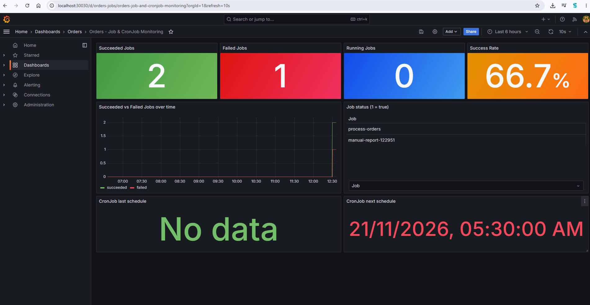

# Orders on Docker Desktop Kubernetes

```
Customer -> POST /orders (Flask API) -> MySQL (orders: PENDING)
                                            ^
Job  process-orders      (PENDING -> PROCESSED) |
CronJob daily-report     (daily 00:00 -> daily_reports table)
kube-state-metrics -> Prometheus -> Grafana (Job success / failure dashboard)
```

## Prerequisites
- Docker Desktop with **Settings > Kubernetes > Enable Kubernetes** turned on.
- PowerShell, `kubectl`, `docker` on PATH.

## Run
```powershell
cd orders-k8s
.\deploy.ps1      # build image, deploy MySQL, API, CronJob, monitoring
.\demo.ps1        # place orders, run Job, run report, run a failing Job
.\cleanup.ps1     # remove everything
```

## URLs
- API: http://localhost:30080
- Grafana: http://localhost:30030 (admin / admin), dashboard *Orders > Orders - Job & CronJob Monitoring*

## Manual usage
```powershell
curl.exe -X POST http://localhost:30080/orders -H "Content-Type: application/json" `
  -d '{\"customer_name\":\"alice\",\"product\":\"book\",\"quantity\":2,\"amount\":19.98}'
curl.exe http://localhost:30080/orders?status=PENDING

kubectl delete job process-orders -n orders --ignore-not-found
kubectl apply -f k8s/20-job-process-orders.yaml
kubectl logs job/process-orders -n orders

kubectl create job manual-report-1 --from=cronjob/daily-report -n orders
curl.exe http://localhost:30080/reports
```

## Notes
- The image `orders-app:1.0` is built locally; manifests use `imagePullPolicy: IfNotPresent`. This works with Docker Desktop's built-in (non-kind) cluster. If you use the kind provisioner, run `kind load docker-image orders-app:1.0`.
- Credentials are demo values in `k8s/00-namespace-mysql.yaml`; change them for anything real.
- Grafana charts come from kube-state-metrics (`kube_job_complete`, `kube_job_failed`, `kube_job_status_active`, `kube_cronjob_*`). Deleted Jobs disappear from the charts.


